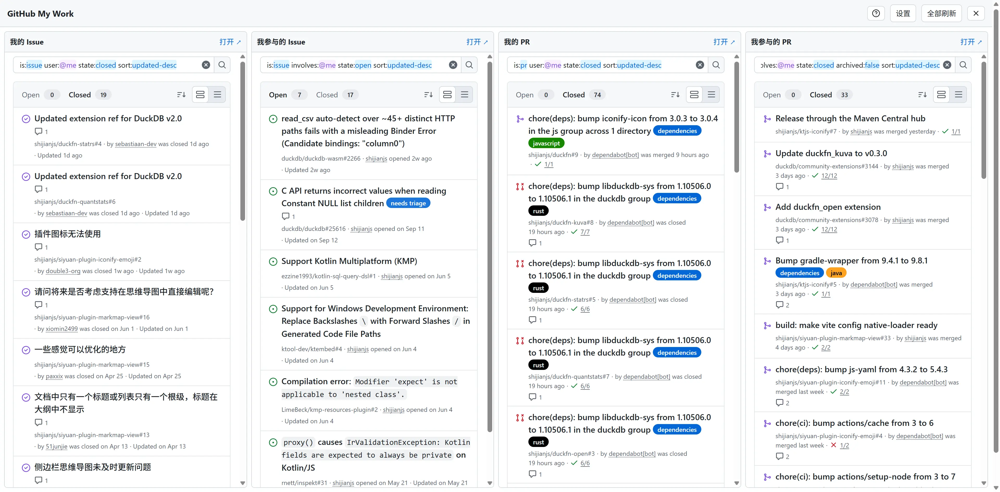

# GitHub My Work — 可配置的多列工作台

[](https://greasyfork.org/zh-CN/scripts/601775-github-my-work-configurable-dashboard)

GitHub Issues / PR 多列工作台。安装后 GitHub 页面右下角会出现 `My Work` 按钮，打开后每列用一个 iframe 展示一个 GitHub 页面——默认是个人 Issue、参与的 Issue、个人 PR 和参与的 PR，也可以换成任意 `github.com` 页面地址。



## 安装

推荐从 [GreasyFork](https://greasyfork.org/zh-CN/scripts/601775-github-my-work-configurable-dashboard) 安装，之后可以跟随版本自动更新：

1. 安装 Tampermonkey、Violentmonkey 或兼容的用户脚本管理器。
2. 打开 [GreasyFork 脚本页](https://greasyfork.org/zh-CN/scripts/601775-github-my-work-configurable-dashboard)，点「安装此脚本」。
3. 安装并配置 [Header Ext](https://github.com/binge6/header-ext)，移除 `github.com` 的 `X-Frame-Options` 与 `Content-Security-Policy` 响应头。否则各列为空白，这是 GitHub 的 iframe 限制，脚本无法绕过。

也可以直接从仓库安装（不会自动更新）：[github-my-work.user.js](https://raw.githubusercontent.com/shijianjs/userscripts/main/userscripts/github-my-work/github-my-work.user.js)。

## 使用

- 点击右下角 `My Work` 打开面板，右上角的 `×` 图标按钮随时关闭，`Esc` 也可以。
- 顶部提示条说明 iframe 被拦截时该检查什么；点右侧的 `×` 关闭，工具栏的 `?` 图标可以随时重新显示。
- `设置` 中可以：
  - 修改每列的标题；
  - 把每列的**类型**设为「搜索条件」或「页面地址」：
    - 搜索条件：GitHub issues 搜索语法，脚本会拼成 `/issues?q=...`，并裁剪掉重复的 GitHub 顶栏、侧栏和页脚，只保留内容区；
    - 页面地址：必须是 `https://github.com/` 开头的地址（可以省略协议，保存时会补全），原样嵌入，不裁剪；
  - 用「添加一列」/ 每行右上角的删除按钮增减列，最多 8 列、最少 1 列；
  - 切换界面语言（自动 / 中文 / English），保存后立即生效。
- 设置页打开时，`保存并应用` / `恢复默认` / `取消` 会出现在顶部工具栏（替代此时用不到的「设置」和「全部刷新」），保存或取消后恢复原按钮。
- 每列的 `打开 ↗` 在新标签页打开对应页面；`全部刷新` 一次刷新全部列。
- 面板主题跟随 GitHub 的亮色、暗色或自动模式，切换时 iframe 内的页面也会一起切换。
- 各列是独立的 GitHub 页面，保留 GitHub 自己的筛选、分页和滚动行为，不是 API 聚合的数据列表。

设置保存在当前浏览器的 `localStorage`，键为 `github-my-work.settings.v2`；1.0 时代的 `github-my-work.settings.v1`（纯数组）会在首次读取时自动迁移为「搜索条件」列。

## 默认列

| 列 | 类型 | 内容 |
| --- | --- | --- |
| 我的 Issue | 搜索条件 | `is:issue user:@me state:open sort:updated-desc` |
| 我参与的 Issue | 搜索条件 | `is:issue involves:@me state:open sort:updated-desc` |
| 我的 PR | 搜索条件 | `is:pr user:@me state:open sort:updated-desc` |
| 我参与的 PR | 搜索条件 | `is:pr involves:@me state:open archived:false sort:updated-desc` |

默认列只在没有保存过设置时初始化一次，之后完全由设置页决定。

## 图标

按钮图标使用 [iconify web component](https://iconify.design/docs/iconify-icon/)（`iconify-icon` 3.0.4，lucide 图标集），通过脚本头部的 `@require` 引入：

```js
// @require https://cdn.jsdelivr.net/npm/iconify-icon@3.0.4/dist/iconify-icon.min.js
```

组件由油猴负责下载并缓存，脚本自己不再插入 `<script>`，也不用管加载时序。图标字形在运行时从 Iconify API 获取，所以首次显示需要联网；断网时按钮仍然可用，只是图标空白。

版本固定在 3.0.4，升级时同时改 `@require` 和本节。

## 运行时验证

`test/e2e.mjs` 是一份 Playwright 用例，通过 CDP 连接一个已开启调试端口的 Chrome，验证 launcher、面板、动态列、URL 列校验、增删列、提示条、语言切换、iframe 裁剪、主题同步、Esc 关闭和窄屏布局。用例不属于分发内容，不需要也无法通过 raw 链接安装。

前置条件：

1. 测试实例里已安装配置好 [Header Ext](https://github.com/binge6/header-ext)（否则 iframe 会被 `X-Frame-Options` 拦截）。
2. 该实例已登录 GitHub。
3. Chrome 以 `--remote-debugging-port=9222` 启动；默认用户目录不允许开调试端口，需复制一份配置再启动，具体步骤见仓库根目录 `AGENTS.md`。

运行：

```powershell
node userscripts/github-my-work/test/e2e.mjs
```

用例默认把仓库里的 `.user.js` 直接注入页面，因此验证的是当前工作区的代码，不依赖 Tampermonkey 里是否装的是最新版本；页面上已有的旧实例会先被移除。注入前会读取元数据里的 `@require` 并先加载这些依赖（真实环境由油猴负责）。想验证 Tampermonkey 里已安装的版本时，设置 `INJECT=0`。

可用环境变量覆盖本机差异（无需写入仓库）：

| 变量 | 默认值 | 说明 |
| --- | --- | --- |
| `CDP_URL` | `http://127.0.0.1:9222` | 调试端点 |
| `PLAYWRIGHT_CORE` | 自动从全局 npm 目录查找 | `playwright-core` 所在路径 |
| `OUT_DIR` | `<仓库>/target/gmw-screenshots` | 截图输出目录 |
| `INJECT` | `1` | `0` 表示使用 Tampermonkey 已安装的版本 |

用例开始时会清空本实例里的脚本设置以获得确定结果，结束时恢复默认列和自动语言；结果条数取决于账号真实数据，只记录不参与断言。

## 安全说明

移除上述响应头会削弱 GitHub 的浏览器端防护。请把 Header Ext 规则限定在 `github.com`，不再使用时关闭。

脚本不需要 GitHub token，也不会把查询发送到外部服务；自定义设置只保存在本地浏览器。外部请求只有两个，且都是图标相关：油猴下载并缓存 `@require` 的 iconify-icon 组件，图标字形再由该组件从 Iconify API 获取。

## 发布到 GreasyFork

GreasyFork 的新建脚本页只有两个输入框：代码框和「Additional info」（Markdown）。脚本名称与描述由头部的 `@name` / `@description`（以及 `:zh-CN` 本地化版本）决定，不需要单独填写。

- 代码框：粘贴 `github-my-work.user.js` 全文。
- Additional info：默认语言填 [greasyfork.md](greasyfork.md)，再点「添加本地化的附加信息」新增英语 (en) 填 [greasyfork.en.md](greasyfork.en.md)。版本更新时同步改两份文件里的更新日志。

## 更新日志

### 1.2.0

- 工具栏的「设置」「全部刷新」与设置页的「保存并应用」「恢复默认」「取消」按钮加上图标；右下角「我的工作」启动按钮加 `briefcase` 图标。图标与文字并排，样式与已有的「添加一列」按钮一致。

### 1.1.2

- 图标改用油猴内置的 `@require` 引入 iconify-icon，交给用户脚本管理器下载与缓存，删除脚本内自实现的动态加载。
- iconify-icon 升级到 3.0.4。
- 删除渲染失败时的内嵌图形降级：图标依赖联网属正常行为，不再用降级掩盖网络问题。

### 1.1.1

- 补充本地化元数据（`@name:zh-CN` / `@description:zh-CN`）以及 `@homepageURL` / `@supportURL`，便于在 GreasyFork 等平台展示中文名称与说明。

### 1.1.0

- 每列可选「搜索条件」或「页面地址」，页面地址必须是 `github.com`；列数可增可减（1–8 列）。
- 查询列注入样式，只保留 `[data-component="PageLayout.Content"]`，隐藏重复的 GitHub 顶栏、侧栏与页脚，并去掉多余的最小高度与空白滚动条。
- 顶部提示条增加关闭按钮，工具栏增加 `?` 图标按钮可重新显示提示；关闭状态会被记住。
- 关闭按钮改为右上角图标按钮，全局可用；设置页的保存/恢复默认/取消移到顶部工具栏。
- 设置页每张列卡片改为两行布局（标题/类型一行、搜索条件整行），卡片变窄后按网格多列排布。
- 修复亮色模式下入口按钮文字不可见（主题变量放在 `:host` 上）。
- 支持中英文界面，可自动检测或手动指定。
- 图标改用 iconify web component，加载失败时退回内嵌 lucide 图形。
- 设置格式升级为 v2（对象），自动迁移 1.0 的数组格式。
- 代码改为面向对象结构（设置、视图、列、表单行、面板、图标各自成类），样式移入 Shadow DOM 隔离。

### 1.0.0

- 初始版本：可配置的四列 Issues / PR 工作台、主题跟随、窄屏横向滚动、设置持久化。
